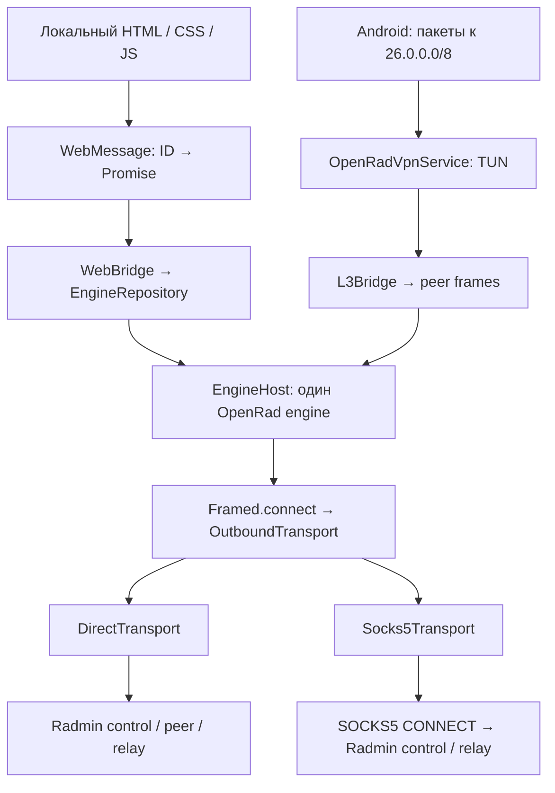

# Архитектура Android Radmin Remote

## Зафиксированная основа

OpenRad `gringoestrangeiro/openrad`, commit `47eb54f6b051aadc37260d405681b2111b50b7cc`.
Сохранён Android-клиент целиком, включая JVM-тесты и MIT LICENSE. Исходная Compose UI оставлена в исходниках для сравнения, но launcher использует только WebView. Никаких Compose-экранов в пользовательском пути нет. Протокол, криптография, provisioning, membership, peer handshake, relay, L3Bridge не переписаны. Изменения в `Transport.kt` ограничены фабрикой TCP-сокетов; в `Udp.kt` проверяется результат protect().

## Точки внедрения

Все исходящие TCP в OpenRad используют `Framed.connect`: provisioning → `Control.open`, основная control-сессия, peer coordination, исходящий direct TCP, `prepareRelay`. Фабрика выбирается через `SocketProtector.outboundTransport`: совместимость со старыми JVM-тестами сохраняется default-реализацией DirectTransport. `Engine.kt` и вызовы криптографии остаются без изменений.

`OpenRadVpnService` загружает зашифрованную proxy-конфигурацию перед стартом engine. Настройки транспорта фиксируются на сессию. Для изменения proxy нужно отключиться. `EngineHost` принудительно включает relayOnly в PROXY и сохраняет это при любых updateConfig. Это предотвращает direct TCP, UDP ENet, входящие direct peer listeners и hole punching. Поэтому это **TCP SOCKS5 + TCP relay**, а не SOCKS5 UDP ASSOCIATE. SOCKS5 должен разрешать исходящие соединения к IP и портам инфраструктуры Radmin.

DIRECT сохраняет upstream-политику: direct TCP/UDP только по Wi-Fi, остальные подключения используют relay. PROXY не имеет скрытого fallback на DIRECT при ошибке. AUTO намеренно не включён: безопасный fallback требует учёта неоднозначных provisioning-ответов, чтобы не регистрировать вторую identity.

## Маршрутизация и protect()

| Трафик | Путь |
| --- | --- |
| Приложения Android → 26.x.x.x | TUN → L3Bridge → шифрованные OpenRad frames → peer channel |
| Остальной IPv4/IPv6 интернет Android | Обычная маршрутизация системы; default route в TUN не добавляется |
| DIRECT: control / relay / direct TCP | Защищённый physical socket → uplink → Radmin |
| DIRECT: peer UDP | Upstream UDP socket, protect() до bind; отказ protect завершает открытие |
| PROXY: control и peer coordination | Защищённый physical socket → SOCKS5 CONNECT → Radmin |
| PROXY: данные peers | TCP relay поверх того же SOCKS5 transport; direct TCP/UDP отключены |
| Proxy test | CONNECT к фиксированному серверу OpenRad; при работающем service используется его protector |

`protect()` не отправляет данные через прокси. Он исключает **внешний сокет** из Android VPN. SOCKS5 handshake на этом же сокете задаёт конечный Radmin endpoint. Отказ protect() завершает соединение. Сокетов к 26.x peers на physical uplink не создаётся для переноса пользовательского IP-трафика: он упаковывается в OpenRad frames. Внешний IP прокси может быть доменным именем; его DNS выполняется Android/JVM, DNS конечных Radmin targets не требуется (upstream передаёт IPv4 literals).

TUN: адрес, полученный от OpenRad, маска /8, единственный маршрут 26.0.0.0/8, MTU 1500. Multicast/broadcast маршруты upstream отключены. Это не системный proxy для остальных приложений. Конфликт с отдельным Happ/VPN остаётся ограничением Android; данный APK сам содержит единственный VpnService.

## Bridge и секреты

- Origin: `https://appassets.androidplatform.net`; контент только из bundled assets.
- `WebViewCompat.addWebMessageListener`: exact allowlist origin + mainFrame.
- `WebViewAssetLoader`, запрещены file/content access, mixed content, внешняя навигация, iframe и сетевые запросы HTML через CSP и перехват запросов.
- Нет `addJavascriptInterface`, eval или вставки пользовательских имён через innerHTML.
- ID запроса → Kotlin coroutine → JSON result/error → JS Promise. До 16 параллельных запросов, payload до 16 KiB, таймаут операций 45 секунд. Запрос VPN consent ожидает действие пользователя; отказ не запускает service.
- Identity и proxy credentials: Keystore-backed EncryptedSharedPreferences, allowBackup=false. При ошибке Keystore нет plaintext fallback.
- Proxy.getConfig не возвращает пароль. Пустое поле при сохранении сохраняет существующий пароль; отдельный флаг удаляет его. Credentials никогда не попадают в диагностику.
- Пароль Radmin-сети не сохраняется, Kotlin CharArray зануляется. JS/JSON/JVM строки не обеспечивают гарантированное стирание памяти; поле формы очищается сразу после отправки.
- Логи ограничены 200 engine events; экспорт создаётся только по кнопке пользователя. Имена сетей, узлов и адреса присутствуют в диагностике, секреты исключены.

## Изменения по файлам

| Файл | Назначение |
| --- | --- |
| MainActivity.kt | WebView, origin gate, VPN consent, системный экспорт TXT |
| web/WebBridge.kt | Асинхронный RPC и адаптер к существующему repository |
| web/DiagnosticLog.kt | Ограниченный process-wide журнал событий |
| transport/OutboundTransport.kt | Direct + SOCKS5 CONNECT, RFC1929 auth, отмена/таймаут handshake |
| proxy/ProxyConfig.kt | Расширяемая конфигурация и зашифрованное хранение |
| engine/Transport.kt | Подмена фабрики TCP без изменения протокола |
| engine/Udp.kt | Проверка protect для direct UDP |
| vpn/EngineHost.kt | Transport status и принудительный relayOnly для proxy |
| vpn/OpenRadVpnService.kt | Snapshot транспорта, только маршрут 26/8 |
| assets/www/* | Шесть адаптивных экранов, реальные данные вместо mock |
| transport/Socks5TransportTest.kt | Локальный fake SOCKS5 и проверки framing/auth/protect/refusal/timeout |
| .github/workflows/android.yml | Unit tests, сборка, APK artifact |

## Границы MVP

Реализованы DIRECT и SOCKS5. VLESS, Reality, Trojan, Shadowsocks, AUTO fallback, SOCKS UDP ASSOCIATE и Radmin Viewer не реализованы. UI честно отключает будущие режимы. Замена SOCKS5 локальным embedded Xray/sing-box возможна через OutboundTransport и управление его lifecycle внутри того же foreground service; второй VpnService не нужен.

Engine предоставляет общий VPN-трафик, статусы peer и RTT; отдельных per-peer byte counters и счётчиков TCP/UDP ошибок upstream не экспортирует. Вместо вымышленных чисел показываются общий traffic и события ошибок. Список подключённых сетей отображается целиком: OpenRad может одновременно состоять в нескольких сетях, единственной «активной» сети в engine нет.

Подключение к существующей Windows Radmin VPN network и реальная мобильная сеть проверяются вручную. Сборка и синтетические JVM-тесты не доказывают эту совместимость и не гарантируют доступность прокси из конкретной сети оператора.
