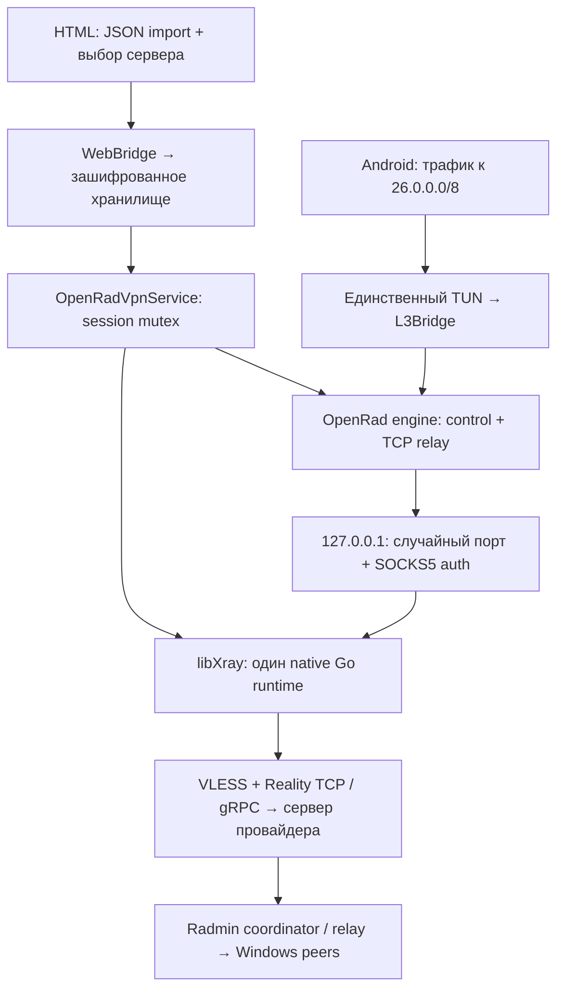

# Xray transport 0.2

## Путь данных

SOCKS5-вход принимает соединения OpenRad, а Xray переносит их к VLESS-серверу. Service запускает OpenRad только после готовности Xray. Android TUN создаёт только OpenRadVpnService; Xray TUN не создаёт.

## Импорт

Вставка JSON или системный OpenDocument picker, до 512 КБ. Из массива outbounds принимаются vless + reality + tcp/raw/grpc. При импорте проверяются UUID, порт, 32-байтовый public key, short ID, flow, fingerprint и обязательные поля. Поддерживаются пустой flow и xtls-rprx-vision; fingerprint включает chrome/edge/firefox/safari и другие перечисленные в коде варианты. Требуются один vnext и один user на профиль. До 32 профилей, до 256 исходных записей outbounds.

Импорт atomically заменяет proxy-профили и выбирает первый, сохраняя Radmin identity и сети. Отсутствие поддерживаемых узлов, повреждённый поддерживаемый профиль или ошибка записи не должны частично заменять прежний импорт. Выбор сохранённого профиля не возвращает credentials в WebView: публичный список содержит только случайный локальный profile ID, tag, host, port и название протокола.

Корневые env, DNS, routing, balancers, observatory, api, metrics, inbounds и прочие поля JSON не выполняются. Не переносятся sendThrough, sockopt, dialerProxy, proxySettings, TLS-файлы и произвольные поля outbound. Runtime-конфигурация генерируется заново: loglevel none; один SOCKS5 inbound на 127.0.0.1 со случайным паролем; один выбранный VLESS/Reality outbound (TCP или gRPC). freedom/blackhole записи исходного JSON пропускаются. gRPC переносит только serviceName, authority и multiMode; Happ mode:false нормализуется в multiMode:false, mode:multi — в true. gRPC с непустым flow отклоняется.

Настройки хранятся в Android Keystore-backed EncryptedSharedPreferences; при отказе Keystore plaintext fallback отсутствует. Исходный JSON не пишется в файл конфигурации, а текстовое поле HTML очищается после успешного импорта. Java/JS/Go строки в RAM не обеспечивают гарантированное стирание памяти.

## Lifecycle

Все операции с native core и engine выполняются вне UI thread, под process-wide mutex. Параллельные Connect/Reconnect не создают второй engine/core. Флаг желаемого состояния позволяет Disconnect, пришедшему во время старта Xray, остановить запуск до старта OpenRad.

1. Foreground notification → загрузка выбранного профиля.
2. Однократная регистрация Go dialer/listener controllers, которые читают актуальный protect callback service.
3. Настройка защищённого Go DNS resolver на DNS обычного uplink, fallback 1.1.1.1:53.
4. Запуск native core из сгенерированного JSON. Случайный loopback порт проверяется реальным SOCKS5 greeting + RFC1929 auth с сессионным паролем.
5. Только после READY стартует OpenRad с OutboundTransport, который использует внутренний SOCKS5.
6. При Disconnect сначала останавливается OpenRad и TUN, затем Xray и его DNS resolver. Reconnect выполняет ту же остановку до нового старта.
7. Отзыв VPN consent и уничтожение service запускают остановку. Закрытие Activity не останавливает foreground VPN.

Проверка открытого localhost порта не считается достаточной. Даже успешный SOCKS CONNECT сам по себе может не доказывать внешний Reality handshake: для XRAY кнопка «Проверить» оценивает существующую authenticated OpenRad control-сессию. Peer PING и доступ к сервису Windows проверяются отдельно.

## Protect и маршруты

Kotlin physical TCP: bind локального порта → protect(socket) → connect. Это относится к DIRECT, внешнему SOCKS5 и соединению с внутренним SOCKS5. Native Go sockets уже имеют OS fd; libXray вызывает callback до connect/listen, service вызывает protect(fd). Неуспешная защита отклоняет сокет. DNS-сокеты Go защищаются SetDNS controller. На остановке вызывается ResetDNS.

В режиме XRAY transport.relayOnly=true. EngineHost принудительно удерживает эту политику при любом updateConfig: direct peer TCP/UDP и hole punching не обходят Xray. Control, provisioning, peer coordination и TCP relay проходят через общий Framed.connect transport hook. Нативный core имеет только один выбранный outbound, без freedom/direct fallback.

Android получает адрес 26.x.x.x и только маршрут 26.0.0.0/8; default route и дополнительный TUN не создаются. Обычный интернет других приложений остаётся на системном uplink.

## Диагностика

Xray: phase, version, stage и безопасный error code. Этапы: REGISTER_PROTECTION, CONFIGURE_DNS, START_CORE, VERIFY_LOCAL_SOCKS, READY, STOPPING. Native error payload не возвращается в UI/логи, поскольку он может содержать параметры конфигурации. В диагностике можно видеть имя и endpoint выбранного профиля, но не UUID, SOCKS-пароль, SNI/public key/short ID или исходный JSON. Режим транспорта — XRAY_VLESS_REALITY; в UI показан короткий VLESS / Reality.

## Проверка на телефоне

1. Отключить Happ; импортировать JSON; выбрать один TCP или gRPC Reality сервер; сохранить.
2. Connect → Android VPN consent → Xray READY → OpenRad CONNECTED → TUN ready.
3. Вступить в Radmin-сеть; дождаться peer CONNECTED/RELAY, измерить PING.
4. С Windows выполнить ping на VIP Android, с Android открыть нужный сервис Windows по 26.x IP.
5. Отключить приложение: notification/TUN/core закрыты. Повторить Connect/Disconnect/Reconnect.
6. Проверить недоступный сервер и неверные credentials: нет скрытого direct fallback, исходная конфигурация не появляется в diagnostics.
7. Поворот/закрытие UI, Wi-Fi ↔ mobile, отзыв consent: один VPN и корректная остановка.

Сборка, JVM-тесты, HTML smoke test и native Linux core test не доказывают работу Go JNI callback, Android DNS, Reality handshake с сервером провайдера и конкретные сетевые ограничения. Эти пункты требуют реального устройства.

## Изменения 0.2.1

Добавлен импорт VLESS/Reality gRPC. Старые сохранённые TCP-профили без поля network восстанавливаются как TCP. Импорт остаётся атомарным; перед импортом и сменой профиля VPN должен быть отключён. AUTO/balancer не переносится.

Перед новым запуском при неработающем engine сервис под общим lifecycle mutex закрывает предыдущие engine, TUN и Xray, затем запускает выбранный профиль с DNS текущего uplink. Это закрывает путь, при котором прежний core оставался READY после исчерпания engine retries и следующая попытка падала до обработки startup-ошибки. В диагностике сохраняется безопасный код и стадия Xray startup failure. Автоматический бесшовный переход между двумя Wi-Fi сетями не добавлен: после смены сети требуется переподключение.

Поля gRPC: [официальная документация Xray](https://xtls.github.io/ru/config/transports/grpc.html). Параметры доступа не используются в тестах. Native smoke проверяет обе конфигурации, аутентификацию loopback SOCKS и закрытие слушателя при повторных циклах stop/start; не проверяет соединение с сервером провайдера.
